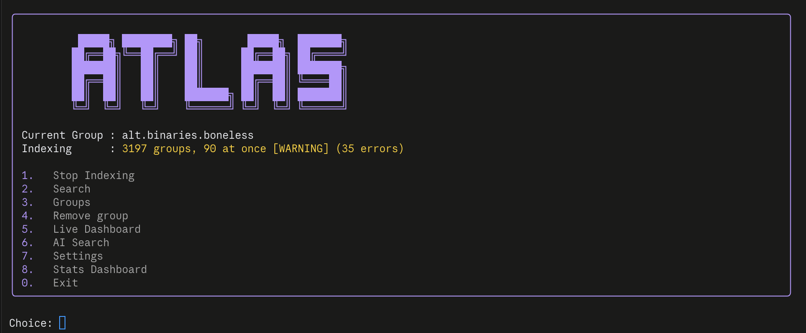
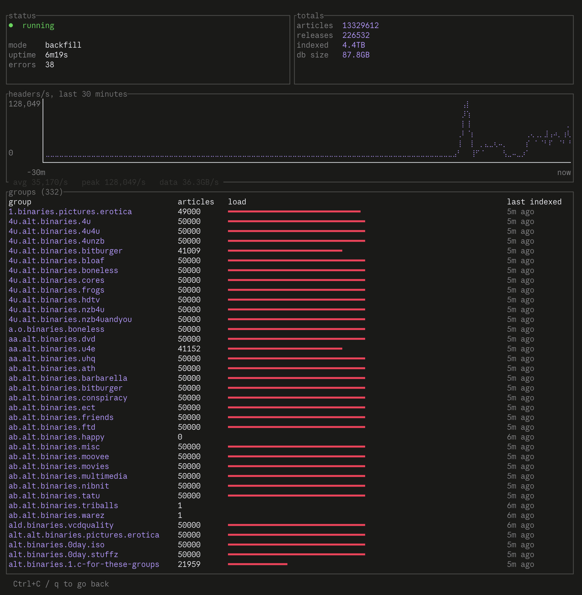
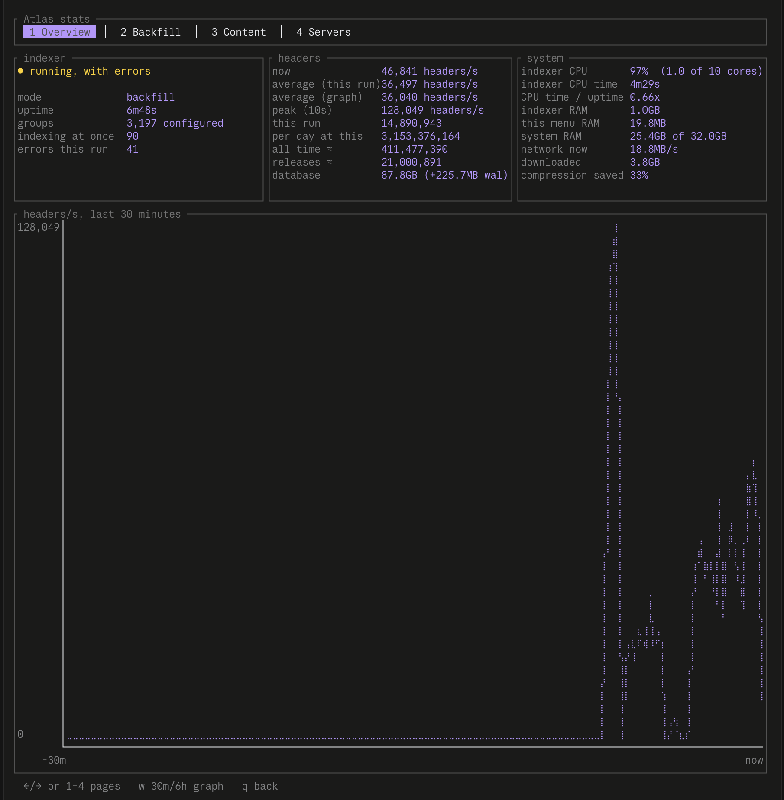
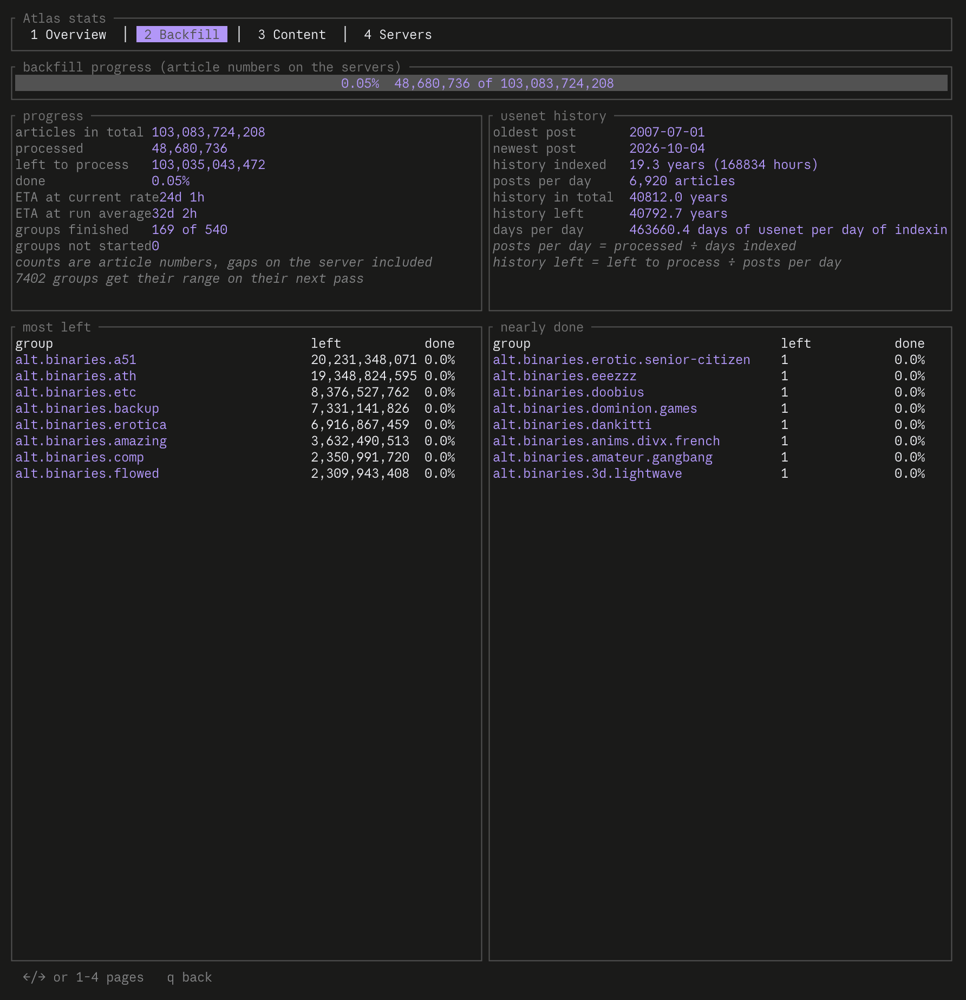
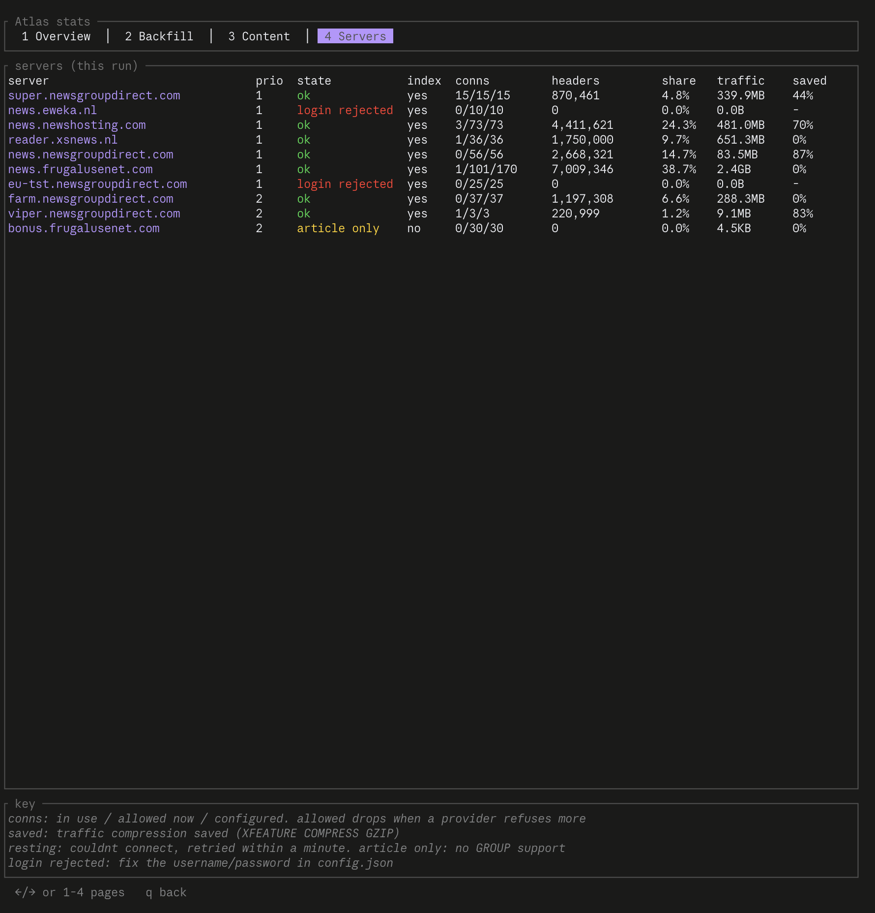

<div align="center">

# Atlas

A self-hosted Usenet indexer and Newznab server that runs in your terminal

[](https://www.rust-lang.org)

[](LICENSE)


[Features](#features) • [Rust](#built-with-rust) • [Install](#installation) • [config.toml](#configure-atlas-configtoml) • [Usage](#usage) • [Stats dashboard](#stats-dashboard) • [Web UI](#web-ui) • [Newznab API](#newznab-api) • [Development](#development)



</div>

---

## Why Atlas

Many Usenet indexers charge a fee. Atlas is a free, open source alternative that you run yourself. It reads headers from your Usenet provider, works out which posts belong together, stores them in a local database, and builds an NZB file, which a Usenet downloader uses to fetch a release, when you find one you want.

Use Atlas from the terminal, or point Prowlarr, NZBHydra2, Sonarr, Radarr, or any other Newznab client at its API to search releases and download NZB files.

## Built with Rust

> [!IMPORTANT]
> Atlas is a single native binary written in **[Rust](https://www.rust-lang.org) 1.99.0**, edition 2024.

The Rust version replaces the original Python version. It keeps the same menus, converts an existing `atlas.db` once into its own faster and smaller layout, and indexes many times faster.

| Component | Crate |
|---|---|
| Toolchain | Rust **1.99.0**, pinned in `rust-toolchain.toml` and set as `rust-version = "1.99"` in `Cargo.toml` |
| Async network I/O | [`tokio`](https://tokio.rs) with [`rustls`](https://github.com/rustls/rustls) for Transport Layer Security (TLS) |
| Terminal UI | [`ratatui`](https://ratatui.rs) |
| Database | [`rusqlite`](https://github.com/rusqlite/rusqlite) with bundled SQLite, Write-Ahead Logging (WAL), and an FTS5 search index |
| Newznab API | [`tiny_http`](https://github.com/tiny-http/tiny-http) |
| System stats | [`sysinfo`](https://github.com/GuillaumeGomez/sysinfo) |

rustup installs the pinned toolchain the first time you build, and the `just` recipes always use it, even when another Rust installation, such as Homebrew's, comes first on your `PATH`.

## Features

- **Index Usenet headers** from the groups you choose, over SSL, in live, backfill, or dynamic mode.
- **Use all your Usenet servers at once.** List as many providers as you like in `config.toml`. Every server indexes in parallel and keeps its connections busy. For example, 4 servers with 25 connections each keep 100 requests in flight.
- **Index fast.** Atlas splits header requests into slices that stream over all connections, saves each slice the moment it arrives, and indexes many groups at the same time. When the server supports it, Atlas requests compressed header listings with `XFEATURE COMPRESS GZIP`.
- **Handle real providers.** Atlas detects fill and bonus servers that only serve articles, lowers its own connection count when a provider refuses more, and pauses servers that reject the login instead of retrying them constantly.
- **Real categories.** Atlas gives each release a Newznab category and honors `cat`, parents included.
- **TV and movie IDs.** Atlas stores each release's title, season, and episode, and answers searches by TVDB, IMDb, TMDB, TVMaze, and Trakt ID once you turn on a provider. Every provider is off by default.
- **Group posts into releases.** Atlas parses subjects into releases, marks incomplete sets, and recovers the real names of obfuscated posts from their par2 or nfo files.
- **Serve a Newznab API** for Prowlarr, NZBHydra2, Sonarr, and Radarr: `search`, `tvsearch`, `movie`, `music`, `book`, `caps`, and `get`, which downloads an NZB.
- **Search from the terminal** in one group or all groups, or use **AI search**, which turns a request like `find me 4k hdr movies` into groups and keywords with a local [Ollama](https://ollama.com) model.
- **Watch progress** on the live dashboard, and dig into CPU, memory, backfill, content, and per-server numbers on the stats dashboard.
- **Keep everything local** in a SQLite database with a full-text index.



## Installation

You need:

- A Usenet provider account with Network News Transfer Protocol (NNTP) access over SSL.
- [Rust](https://rustup.rs). rustup installs the pinned 1.99.0 toolchain automatically.
- Optional: [just](https://github.com/casey/just) for the shortcuts in this guide.

```bash
git clone https://github.com/Appz4Fun/Atlas
cd Atlas
just run            # or: cargo run --release
```

`just run` and `cargo run` keep `config.toml`, `atlas.db`, and the logs in the repository folder, as set in `.cargo/config.toml`. The Python version kept them in the same place, so an existing setup carries over. To see which Rust the recipes use, run `just toolchain`.

To install Atlas as a command instead:

```bash
cargo install --path .
atlas
```

Atlas keeps its data in `~/.atlas` unless `ATLAS_HOME` points somewhere else. A binary with a config or `atlas.db` already next to it keeps using that folder, so an older install carries on as it was. To move one, stop Atlas and move those files to `~/.atlas`.

```text
usage: atlas [--selftest | --bg-indexer | --convert]

  (no args)     interactive menu
  --selftest    check the login on every usenet server and exit
  --bg-indexer  run the indexing loop headless (the menu starts this for you)
  --convert     move a database from before the shards into them, then exit
                (the indexer does this on its own when it starts)
```

### Prebuilt binaries

When you push a release tag (`v*`), the `build-executables` workflow builds `atlas-linux`, `atlas-macos`, and `atlas-windows.zip` (the executable and an `atlas.bat` launcher) and attaches them to the GitHub release.

- **Linux and macOS:** `chmod +x atlas-linux && ./atlas-linux`
- **Windows:** extract `atlas-windows.zip` and double-click `atlas.bat`, or run `.\atlas-windows.exe` from a terminal.

## Configure Atlas (`config.toml`)

An existing `config.json` converts itself at the next start. Atlas writes `config.toml` and keeps the old file as `config.json.bak-toml`, which you can delete once you are happy. Comments you add to `config.toml` stay when Atlas saves a change, except on a key it changes.

On first run, Atlas asks for one server (host, username, password, and port) and writes `config.toml`. You can edit everything else in the menus or directly in the file. The repository includes a template without secrets, [`config.example.toml`](config.example.toml).

### Full example

```toml
group = "alt.binaries.example"
groups = ["alt.binaries.example", "alt.binaries.another"]
index_mode = "dynamic"
batch_size = 500000
request_size = 10000
parallel_groups = 20
api_host = "0.0.0.0"
api_port = 9090
api_key = "generated-on-first-start"

[[usenet_servers]]
host = "news.provider-a.com"
username = "me"
password = "secret"
port = 563
ssl = true
connections = 50
priority = 1

[[usenet_servers]]
host = "news.provider-b.com"
username = "me"
password = "secret"
port = 563
ssl = true
connections = 30
priority = 2

[[usenet_servers]]
host = "fill.provider-c.com"
username = "me"
password = "secret"
port = 563
connections = 20
priority = 3
index = false

[[usenet_servers]]
host = "news.local-test"
username = "me"
password = "secret"
port = 119
ssl = false
compress = false
```

### Top-level keys

| Key | Default | Meaning |
|---|---|---|
| `usenet_servers` | | List of servers. See [Server fields](#server-fields-usenet_servers). |
| `groups` | `[]` | Newsgroups to index. Add them from the Groups menu or edit the list. |
| `group` | | The current group, used by the menu's current-group search. |
| `index_mode` | `dynamic` | `dynamic` alternates backfill and live passes, `backfill` indexes older posts only, and `live` indexes new posts only. |
| `batch_size` | `500000` | Article numbers per indexing pass over a group. The cursor moves only after a whole pass finishes. |
| `request_size` | `10000` | Article numbers per header request, which is one connection's slice of a pass. Providers spend most of a request's time on their side, so on old articles 10,000 per request is 3–6 times faster per connection than 1,000. |
| `parallel_groups` | 1 per 5 connections | Total groups indexed at the same time, shared between servers by their `connections`. Every server gets at least one. |
| `api_host` | `127.0.0.1` | Address the Newznab API listens on. Use `0.0.0.0` to reach it from other machines. |
| `api_port` | `9090` | Newznab API port. |
| `api_key` | generated | Newznab API key. Atlas creates it on first start and stores it here. |
| `split_min_backlog` | `10000000` | Article numbers of backfill left before a group's backfill is split into day chunks that every server carrying the group can take. |
| `auto_run_compact` | `false` | Compact the database every 24 hours; indexing pauses while it runs. |
| `postprocess` | see below | The stage releases go through after saving. See [Post-processing keys](#post-processing-keys). |
| `archive` | see below | Reading archives, PAR2 sets, and NFOs inside releases. See [Archive inspection](#archive-inspection). |
| `naming` | see below | Giving releases with junk names better ones. See [Name fixing](#name-fixing). |
| `predb` | see below | A catalogue of scene and P2P titles, off by default. See [PreDB](#predb). |
| `category` | see below | How releases get a category. See [Categories](#categories). |
| `media` | see below | TV and movie IDs, with every provider off. See [TV and movie IDs](#tv-and-movie-ids). |
| `metrics` | see below | Prometheus metrics, off by default. See [Metrics](#metrics). |
| `max_unsaved_headers` | `500000` | Headers the indexer fetches ahead of saving them, over all groups at once. This bounds its memory: 500,000 headers take about 0.3 GB. A header request waits for room before it goes out, and its room comes back once its slice is saved. Raise it if the Bottleneck page shows it full while the database writers and connections have time to spare. Set below `request_size`, header requests are cut down to it, which makes them small and slow. |

Atlas keeps any other keys you add to the file when it saves it.

### Post-processing keys

All of these go in a `postprocess` object, and each has a default. See [Post-processing](#post-processing).

| Key | Default | Meaning |
|---|---|---|
| `enabled` | `true` | Run the stage. It uses no network on its own. While it's off, saves still queue releases for it. |
| `workers` | `2` | Threads for database steps. |
| `settle_secs` | `7200` | Quiet time before an incomplete release is looked at. |
| `complete_settle_secs` | `900` | The same for a complete release. |
| `min_size_bytes` | `0` | Reject anything smaller. `0` is off. |
| `min_files` | `1` | Reject anything with fewer files. |
| `reject_par2_only` | `true` | Reject a post whose files are all par2. |
| `group_rules` | `{}` | `{"group": {"min_size_bytes": n, "min_files": n}}`. The larger of a group's value and the global one counts. |
| `backlog_per_second` | `2000` | Existing releases looked at, over all shards. `0` stops it. |
| `body_fetches_per_minute` | `600` | Body budget. At `0`, nothing fetches bodies. |
| `body_connections` | `2` | Bodies in flight at once. |
| `body_min_size_bytes` | `1048576` | A smaller release gets no body. |
| `body_max_size_bytes` | `107374182400` | A larger release gets no body. `0` is no limit. |
| `body_max_bytes` | `16777216` | Largest article read. |
| `bodies_per_release` | `8` | Bodies per run of a step. |
| `min_completion_percent` | `95` | Below this a release gets no body, and `--purge --dead` can take it. |
| `dead_after_secs` | `172800` | Quiet time before purge may delete anything but a blocked group's rows. |
| `max_attempts` | `5` | Failed attempts before a step gives up on a release. |

### Server fields (`usenet_servers`)

| Field | Default | Meaning |
|---|---|---|
| `host` | | The provider's NNTP server, domain only. |
| `username`, `password` | | Login. With the old single-server layout, Atlas stores the password in the OS keyring when possible. In `usenet_servers`, a password already in the file stays there. |
| `port` | `563` | `563` is SSL and `119` is plain text. |
| `ssl` | from the port | Forces SSL on or off. |
| `connections` | `10` | Requests Atlas keeps in flight on this server at once. Set it to what your plan allows. See [Measure connection limits](#measure-connection-limits). |
| `priority` | `99` | Order of the servers for failover and for par2 and nfo lookups among equally busy servers. Lower values come first. Servers with equal priority keep their order in the file. |
| `index` | `true` | Whether the server takes part in indexing. `false` keeps it for article lookups only, for example a block account whose data you don't want to spend on headers. |
| `compress` | `true` | Requests gzip-compressed header listings. Servers without compression get plain requests, and Atlas turns compression off for a server that sends unreadable data. |
| `key` | | Sets the server apart in Atlas's stored progress (cursors, day chunks, sweeps). Atlas names a server by its host, plus `:port` when the port isn't the default for its SSL setting, and adds `#key` when this is set. Adding or removing other servers never changes the name. Set it only for a second account on the same host and port whose provider numbers articles differently; otherwise both share one progress. |

The old single-server layout, with `host`, `username`, `password`, and `port` at the top level, still works and becomes a one-server list.

### How Atlas uses the servers

- **Indexing uses every server at once, whatever its priority.** Atlas spreads groups over the indexing servers in proportion to their `connections`, and each server runs its own groups, so all connections stay busy. Each group stays on one server, because article numbers, and therefore the indexing cursors, differ between providers. A server that stops answering hands only its own groups to the others for a while.
- **A group that a server doesn't carry:** Atlas looks it up on the other servers.
- **par2 and nfo articles:** Atlas asks the least busy indexing server first, so lookups don't all queue on one server. If it doesn't have the article, Atlas asks the other indexing servers from least to most busy, and then the remaining servers, such as those with `index: false`, in priority order.
- **A server that can't connect:** Atlas skips it for a minute and moves its groups to the other servers. When a group moves, its cursor on the new server starts from the top. Atlas re-scans those articles but de-duplicates them, so it doesn't store anything twice.

Atlas also handles these provider quirks on its own:

- **Fill and bonus servers** that only serve articles answer `GROUP` with an error. Atlas detects them and uses them for article lookups only. Setting `"index": false` does the same up front.
- **Connection limits:** if a provider refuses another connection while Atlas already has some open to it, Atlas lowers that server's connection count by one and waits for a free connection instead of failing requests. The cause is usually your plan's limit or another app on the same account. Atlas logs this once per server.
- **Wrong username or password:** a rejected login takes that server out of use for 30 minutes and logs one clear message, instead of retrying every minute.

### Changes apply live

The background indexer reads `config.toml` again every 5 seconds:

- New groups, `index_mode`, `batch_size`, `request_size`, and `auto_run_compact` apply immediately.
- Changes to servers, logins, `connections`, `parallel_groups`, or `max_unsaved_headers` rebuild the connection pool. A login you fix in the file, or in **Settings > Usenet servers**, takes effect within a few seconds.
- `api_host` and `api_port` apply when the API restarts. Restart Atlas, or use **Settings > Change API port**.
- `metrics` applies when Atlas restarts.

### Measure connection limits

To find out what each provider allows, stop indexing and run:

```bash
ATLAS_HOME=. cargo run --release --example probe_connections -- --max 300
```

The probe opens and logs in connections on every server until the provider refuses one, reports the maximum per server, and checks whether servers on the same account share a limit. Set `connections` below the measured maximum, for example to 75%, to leave room for other apps on the same account.

## Usage


### First-time setup

On first run, Atlas asks for your provider credentials:

| Field | What to enter |
|---|---|
| Host | Your provider's NNTP server, domain only. For example, `news.yourprovider.net`. |
| Username | Your provider username. |
| Password | Your provider password. |
| Port | `563` for SSL. Keep the default. |

To quit without writing anything, leave the host empty. This helps when your `config.toml` is in another folder: point `ATLAS_HOME` at that folder. The startup panel always shows which `config.toml` Atlas loaded. To add more servers, use **Settings > Usenet servers** or edit `config.toml`.

### Main menu

| Option | What it does |
|---|---|
| 1 | Start or stop indexing. |
| 2 | Search indexed releases. |
| 3 | Find and add groups. |
| 4 | Remove a group. Shown when you have more than one group. |
| 5 | Open the [live dashboard](#live-dashboard). |
| 6 | Run an [AI search](#search). |
| 7 | Open [Settings](#settings). |
| 8 | Open the [stats dashboard](#stats-dashboard). |
| 0 | Exit. |

### Select groups

Open **Groups**, search with at least 3 letters, for example `movies`, and enter a number to add that group. The list shows only binary groups that have articles. To remove a group, use **Remove group** in the main menu.

Atlas never indexes, fetches from, or serves a group whose name labels it for minors (`filters::group_blocked`). Blocked groups are left out of the list, and a blocked group already in your config gets a warning here and stays in **Remove group**.

### Index

> [!NOTE]
> Indexing reads headers from your Usenet provider. It doesn't scan your computer.

Start the indexer from the main menu with option 1. The indexer runs as a background process (`atlas --bg-indexer`), so it keeps running after you close the menu, and it indexes many groups at once on all your servers. The menu shows its state, for example `3197 groups, 90 at once`. When a server or group has trouble, the menu adds `[WARNING]` and an error count. The details are in `bg_index.log`.

| Mode | Behavior |
|---|---|
| `dynamic` | Alternates backfill and live passes, so Atlas keeps up with new posts while it builds history. |
| `backfill` | Indexes backward from the newest article only. |
| `live` | Indexes forward from the newest article only and ignores older posts. |

Some uploads give every article its own random subject, so each article would become a release that can never complete. Articles obfuscated per article are skipped and counted. They still count as received, so the cursors move past them.

Rows already stored from a blocked group stop being served as soon as you run this build, with no purge needed. They stay on disk until you delete them.

A multi-file post becomes one release, whatever its files are called, across slices, servers, and days. Atlas decides this from the post's file counter and from per-group collection regexes, and the subject alone settles it, so every server agrees. A post being indexed when you upgrade stays split by file for the files already started.

An upload obfuscated per article gives every article its own random name, so nothing but its shape, poster, and day links them. Atlas gathers those articles into one release per upload, named `per-article-upload-...`, with each article in its position, so its NZB holds the upload as posted and later articles join it. Grouping by shape can put two uploads by one poster on one day together. See [docs/TODO.md](docs/TODO.md).

### Splitting big groups

When two or more indexing servers carry a group and its backfill has more than `split_min_backlog` article numbers left, Atlas splits the rest of its history into UTC day chunks. A worker with nothing of its own to do claims the newest pending chunk on any server that carries the group, so idle connections help with big groups. A server that doesn't keep a day from its start, because its retention is shorter, gives the chunk back for a server that does. No server keeps the oldest day of the split from its start; the server that goes back furthest on it indexes what there is. Every hour, and when the indexer starts, Atlas checks whether a server now goes back further, for example one you added. If one does, the older days get chunks too, and the old oldest day is done again in full. Live indexing stays on the group's home server. The Backfill page of the stats dashboard shows split groups and their day chunks.

### How the database is stored

Atlas splits releases and their articles over 8 database files next to `atlas.db`, named `atlas.s0.db` to `atlas.s7.db`, by group. Each file has its own writer thread, so the 8 save in parallel, and slices that arrive while a writer is busy are saved together in one transaction. `atlas.db` keeps the per-group cursors.

Articles are stored compactly, at about a quarter of the space of the old layout: a post's files share one release through the `collections` table, each file of a release is stored once with the subject its NZB uses, and each article is a short row with its message ID, part number, and size. Message ID locals are packed by alphabet using specialized encodings (hex at half the size for hexadecimal locals, base-N encoding for other alphabets), and domains are shared. NZBs come out exactly as before.

Atlas seals each file that is complete, or untouched for three days, into one zstd-compressed blob, which takes far less space than its article rows. Each shard writer seals the files its own saves completed between saves, up to 2,000 files or 100 milliseconds at a time, and looks through its shard for files untouched for three days once a minute. Writers leave files from before the upgrade alone; the first `--compact` seals those. Articles that arrive after a file is sealed are stored as rows and merged into its NZB. The `--compact` command seals every file that's due and re-encodes message IDs across the whole database.

A release ID tells Atlas which file holds the release, and IDs keep counting up across all 8 files in the order releases are added, so the newest releases still come first.

PreDB titles, if you turn them on, live apart in `atlas.predb.db`. Compaction and conversion never touch it. It takes about 153 MB per million titles, and grows by under 2 MB a day.

### Converting an older database

The first time the new indexer starts on a database from an older version, it converts it once:

1. It copies every release, then every article, into the 8 files.
2. It builds the search indexes.
3. It checks a sample of releases: their NZBs, sizes, part counts, and completeness must come out the same as from the old database.
4. Only then does it swap the files. The old database stays as `atlas.old.db`; delete it once you're happy.

The menu shows the progress meanwhile, and searches don't work until the conversion finishes. On a 488 GB database it takes about 1.5 hours. If anything fails, Atlas leaves the old database as it was and tries again on the next start. To convert in the foreground instead, stop indexing and run `atlas --convert`. It refuses to start while the indexer, a compaction or another `--convert` is using the database.

Release IDs change in the conversion, so NZB links that Prowlarr or your apps saved before it no longer work. Search again to get the new ones.

### Compacting a database

The `--compact` command rewrites every shard into a fresh database file while the indexer is stopped. It re-encodes message IDs with the current packing and seals every file that's due. The copy has no free space in it. Expect the first compaction to shrink the database a lot, roughly from 138 GB to 60 GB on a full database. Atlas checks each shard's copy before it replaces the original. If a shard fails, Atlas keeps its original and reports the error; the other shards are still compacted.

With `auto_run_compact` set to `true`, the indexer compacts the database every 24 hours. Indexing pauses while it runs and resumes afterward. Stopping the indexer during a compaction stops it within seconds and keeps the originals of unfinished shards. A failed shard is tried again 24 hours later. While a compaction runs, it holds a lock on the `atlas.compacting` file next to `atlas.db`, and the indexer, the menu's AI search saves and the broken release purge refuse to run until it's done. A compaction doesn't start while the indexer runs (outside its own auto compaction), while one of those is saving, or while another compaction runs; auto compaction then tries again 10 minutes later. The lock goes away with the process that holds it, so a crash leaves nothing to clean up (the file itself stays). A crash in the middle of swapping a shard can leave its original moved aside as `atlas.sN.precompact.db` with nothing in its place. The next start of atlas, the indexer or a compaction puts it back (and removes the half swapped copy), taking the lock first. A shard that is missing with no backup next to it, while the other shards are there, stops atlas from starting instead of being made again empty; put it back first. A shard with an `atlas.sN.precompact.db` next to it, when it isn't known which of the two is whole (the crash may have come after the copy went in, or an older atlas made an empty shard beside the backup), is not touched: the menu still opens, but the indexer, AI search saves and purging refuse to write, and the message names both files and how to go on (keep the shard and delete the backup, or the other way round).

A compaction stops a shard and keeps its original if the shard holds a table or column this build doesn't know, since a copy would lose it. It waits up to 10 seconds for a reader that is on its way out.

A group that has caught up rests for 10 seconds before Atlas checks it again. Atlas parks a group that fails 3 times in a row for 5 minutes.

Stopping the indexer takes about a second. Atlas drops any requests still in flight and closes their connections instead of reusing them. A pass that didn't finish leaves its cursor where it was, so Atlas indexes that range again on the next start.

### Post-processing

The indexer takes every saved release through a stage that survives restarts. Upgrading doesn't change network use: with an existing `config.toml` the stage fetches nothing.

- A release is **settled** when no article has arrived for `settle_secs` (2 hours), or `complete_settle_secs` (15 minutes) if it's complete.
- It's **rejected** when no step can help it: a fragment of an upload obfuscated per article, a blocked group, an empty row, or a post of only par2 files. A rejection writes nothing, and a late article judges it again.
- It's **done** when it's settled, passed, and every step that applies has finished or given up. A new article brings it back.

Size, file type, and completeness never reject a release. They only decide whether it gets article bodies fetched.

Steps run in two lanes. Database steps never wait on the network. Body and outside steps run within a budget, one per claim, and an outage costs them no attempts. Bodies are on by default, and `postprocess.body_fetches_per_minute = 0` turns them off. Your existing releases enter newest first at `backlog_per_second`, and the Post-processing page of the stats dashboard shows how far along that is.

### Article probes

Each release gets a look at a few of its articles, without being downloaded: `ARTICLE` on the first and last article of its main file, `STAT` on the middle one, and the first article of up to three NFO, SFV or text files. All of it counts against the body budget, and `archive.enabled = false` turns it off. The release page shows:

- **yEnc:** the real file name and size, parts, line length, article size and the file's CRC32, from the `=ybegin`, `=ypart` and `=yend` lines.
- **Checks:** whether the parts cover every byte, whether the first part's size and checksum are right, the share of overhead, and whether a server still has the first, middle and last articles.
- **What's in it:** MKV and MP4 tracks, with resolution, codecs, bit depth, HDR, Dolby Vision, languages and subtitle flags, read through a RAR that only stores its files. For an archive, its format, method and encryption, and its first file's name, size and CRC32.
- **How it was posted:** the posting tool, dates, path, organization, injection info and crossposted groups, from the article's headers.
- **NFO and SFV:** the NFO's text, IMDb ids and any password in it, and the SFV's checksums.

CRC32 and posting tool can be clicked or searched on, under More fields.

### Archive inspection

Once Atlas may fetch bodies, it reads the releases it can afford to, one at a time and within the budget. It reads a release's PAR2 set, one article of its first archive volume (about 740 KB), plus the last article of a 7z or ZIP, and an NFO if nothing else named it. It doesn't unpack anything. It stores:

- The files inside: their names and unpacked sizes, with the volumes of a set collapsed into one row.
- Whether the archive is passworded: yes when the bytes prove it, maybe when an archive was found but its contents couldn't be seen, and no when names were read with no encryption flag.
- A real name, when the release has none. A name from inside an archive replaces only an obfuscated or random-looking one.

It runs on the body budget, `postprocess.body_fetches_per_minute`. All of these go in an `archive` object, and each has a default:

| Key | Default | What it does |
|---|---|---|
| `enabled` | `true` | Read archives, PAR2 sets, and NFOs. It does nothing until there's a body budget. |
| `max_bodies_per_release` | `4` | Articles the archive step may read per release, from 1 to 16. |
| `probe_files` | `2` | Random-named files to probe per release, from 0 to 8. |
| `probes_per_minute` | `60` | Probes per minute, from 12 to 600. |
| `max_names_mb` | `16384` | Total MiB of stored file names, split between the shards. Past it, passwords and names still work, but no more inner files are stored. The stats dashboard counts what went unstored. |

With a budget set and `archive.enabled` on, names stop being looked up while a release saves, so saving no longer waits on article bodies. A new release has no real name until its step runs, which takes 15 minutes to 2 hours of settling plus the queue. Until then, search hides it if it's obfuscated. A release outside `body_min_size_bytes` and `body_max_size_bytes` gets no body, so it gets no name from these steps, where the lookup while saving would have named it. If you take the budget away, or turn `archive.enabled` off, the lookups come back.

A file with no extension Atlas knows gets probed, if it has at least 3 parts. A probe reads the article's first 64 KiB and hangs up. That's also what it reads of an image it couldn't recognize by name, and an image ends the release. Each hang-up means a new login for the next request, and a provider that refuses a burst of logins rests that server for 30 minutes, indexing included, so probes are spaced by `probes_per_minute`. Lower it if that happens.

These are estimates, not measurements. A release typically costs 1 to 3 bodies, and at most 8. About 15 million of 118 million releases pass the body gates, which comes to about 78 days at 300 bodies a minute, or about 4 days at 6,000, and about 14 TB of traffic in all. Inner files add about 1% to the database. New posts go ahead of the backlog.

### Name fixing

A release whose posted name is junk gets a release-like name from what Atlas already knows. It looks at evidence in this order, and stops at a name in full scene form:

1. The file names in the release's PAR2 set.
2. The file names inside its RAR, 7z, and ZIP archives. From a passworded archive, only a good name counts, because that's where fakes live.
3. Naming regexes, 1,154 of them per group, over up to 4 of its subjects. Failing that, a name in full scene form that those subjects state outright and agree on.
4. Its posted file names.

If the release has an NFO and still no good name, a separate step reads the NFO.

A good name looks like a release: words and a marker such as a year, an episode, a resolution, or a group. Numbers, sample files, installers, random strings, and bare words such as `Inception` don't count. Regexes and posted files need a good name. File names from inside the post may be plainer, because a book title has no marker. A name in full scene form has at least 4 words, a group, and a technical token.

Names only improve. A name replaces another only if its source is at least as good and its grade is strictly better, so a well-named post keeps its name and a second run changes nothing. A season pack is never renamed to one of its episodes.

All of this is database work with no network, apart from the NFO step, which needs `postprocess.body_fetches_per_minute`.

Upgrading names only releases that have no name, starting with a walk over your existing releases at `backlog_per_second`. To replace names the old lookup found too, run `atlas --reprocess --step naming --apply`, which only takes names that grade better. To undo names from regexes and posted files, run `atlas --unname --apply`. They stay cleared, even when a late article arrives, until you run `--reprocess --step naming --apply` again. A better source can still name them, such as an NFO, a PAR2 set, or PreDB.

These go in a `naming` object:

| Key | Default | What it does |
|---|---|---|
| `enabled` | `true` | Run the naming step. Set it to `false` before restarting to hold back the walk. |
| `nfo_step` | `true` | Read NFOs, while `archive.enabled` is also on. It fetches nothing without a body budget. |

### PreDB

Atlas can keep a catalogue of scene and P2P release titles from public JSON feeds, in its own file, and use it to give a release its exact name. A release matches on its title, on the title with different separators, on an MD5 or SHA-1 of the title, or on an inner file. A title beats any other name. Nothing is ever matched fuzzily, and anything ambiguous is no match.

It's off by default: with no `predb` key, nothing is fetched, no file is made, and no step runs. To turn it on:

```toml
[predb]
enabled = true
sources = ["predb_club", "predb_net"]
```

When you turn it on, Atlas contacts the third parties you list, and walks your existing releases once at `backlog_per_second`.

| Source | Contacts | What it's for | Load |
|---|---|---|---|
| `predb_club` | `predb.club` | Recent scene titles | At the defaults, up to 3 requests per 5 minutes |
| `predb_net` | `api.predb.net` | Recent scene titles, about 4 days back | The same |
| `xrel` | `api.xrel.to` | Scene titles | The same, and never over 900 requests an hour |
| `xrel_p2p` | `api.xrel.to` | P2P titles | The same |
| `predb_org` | `predb.org` | History, through `history_pages` | The same |
| `predb_ovh` | `predb.ovh` | Scene titles | The same |
| `srrdb` | `api.srrdb.com` | Scene titles, with no pre time | The same |
| `predatabase` | `predataba.se` | The newest ten titles | One request a poll |
| `predb_me`, `scnsrc_me`, `eztv`, `nfodb`, `one_techno`, `one_gabba`, `ddlvalley`, `hdencode`, `hdencode_tv`, `mp3scene`, `gload`, `hdworld`, `movieblog`, `scnlog` | Each one's RSS feed | Recent titles | One request a poll |
| `apibay`, `knaben` | `apibay.org`, `api.knaben.org` | Recent movie and TV names | One request a poll |
| `crowdnfo`, `nima4k`, `g4u`, `gabber`, `seriousaboutsound` | Each site's listing page | Recent titles | One request a poll. A site that changes its page reads as no rows, and backs off |
| `nswdb`, `3dsdb`, `dats_pciso_1998`, `nzedb_archive` | Each one's whole catalogue | Older titles | One request a week |

All of these go in the `predb` object:

| Key | Default | What it does |
|---|---|---|
| `enabled` | `false` | Make the file and run the feeds and the match step. Off: no file, no network, no step. |
| `sources` | `[]` | The feeds to poll. Empty with `enabled` on: matches against what's in the file, with no network. |
| `poll_minutes` | `5` | Between polls of a source. At least 1. |
| `page_size` | `100` | Clamped to each source's range. |
| `max_pages_per_poll` | `3` | Requests per source per poll, from 1 to 20. A poll with a gap to finish or history to read takes at least 2. |
| `max_db_mb` | `8192` | Polling stops, with an error on the dashboard, once `atlas.predb.db` passes this. At least 64. |
| `request_delay_ms` | `1000` | Between requests to one source. At least 250, and a source's own floor applies. |
| `timeout_secs` | `15` | For a whole request, from 1 to 120. |
| `history_pages` | `0` | Older pages to read in total per source, beyond catching up. |
| `late_per_second` | `1` | Titles the late path takes per second. 0 turns it off. |

A title that arrives after its release still finds it, through the name index or the full-text index, with no scan. It misses a title that appears only in a file that isn't the release's name, or a short title under any form but an exact name. `atlas --reprocess --step predb_match --apply` catches those.

A feed that fails backs off, up to every 6 hours, and only that feed. A server's rate limit is obeyed for as long as it asks. These feeds' shapes come from upstream's source and weren't checked against a live response, so on first turning this on, look at the PreDB block on the Post-processing page of the stats dashboard. A feed that has changed shows its error there, with nothing bad stored.

To load a list you already have, one `title` or `title<TAB>category<TAB>pre_at` per line, optionally gzipped:

```bash
atlas --predb-import titles.txt.gz
atlas --predb-import titles.txt.gz --apply
atlas --reprocess --step predb_match --apply
```

The first is a dry run. Stop indexing before you `--apply`. The last matches your releases to what you imported, because a bulk import skips the late path.

### Purging and reprocessing

Both commands are dry runs until you add `--apply`.

`atlas --purge` deletes what no step can help. On its own it takes only fragments. Each other class has its own flag, and a release counts once, in the first class that takes it:

| Flag | Takes | Age needed |
|---|---|---|
| `--fragments` | Single middle parts of uploads obfuscated per article | `dead_after_secs` |
| `--blocked` | Blocked groups. The dry run lists each group with its counts. | None |
| `--too-small [--below BYTES]` | Releases under `--below`, by default `body_min_size_bytes`. The dry run shows a size histogram. | `dead_after_secs` |
| `--image-only` | Releases whose every file is an image | `dead_after_secs` |
| `--rejected` | Par2-only and empty posts, and posts under `min_files` | `dead_after_secs` |
| `--dead` | Releases under `min_completion_percent` | `dead_after_secs` |

Stop indexing first, review the dry run (`--sample N` prints names), run it with `--apply`, then run `atlas --compact`, which is what gives the space back. A stopped run carries on from where it was. As estimates, deleting up to 34 million fragments takes about 35 minutes to 2.4 hours, and the compaction after it 1 to 2 hours, with free disk equal to the new total.

`atlas --reprocess` looks at stored releases again. `--step NAME` runs a step again, `--step all` runs every one, `--group NAME` limits it to a group, and `--failed` gives failed steps another try. It only queues the work, so it runs beside the indexer.

`atlas --reflag-obfuscated` flags old releases that the current check calls random, such as dotted, hyphenated, and short random names. They leave search and the API listing unless they have a real name. `atlas --unname` clears names taken from naming regexes and posted files, and brings later steps back to the release. Neither touches a name from an NFO, a PAR2 set, or an archive. Both are dry runs until you add `--apply`, take `--sample N` to show some names, and refuse to run with an indexer or a compaction going.

These are estimates. Over 118 million releases, `--reflag-obfuscated` takes about 2 to 10 minutes and writes at most about 12 GB of WAL. `--unname` of 15 million names takes about 5 to 10 minutes and writes about 30 to 60 GB of WAL. If a reader such as the API or the menu holds the WAL past 4 GiB in a shard, the command stops and says so. Run it again to go on from where it stopped.

### Live dashboard

Menu option 5 shows the indexer status, totals, a graph of headers per second over the last 30 minutes, and progress for each group. The totals include `skipped`, the articles left out as obfuscated per article. To go back, press `q`, `Esc`, or `Ctrl+C`.

### Search

- **Current group:** searches only the group you're in.
- **All groups:** searches everything you've indexed.
- **Obfuscated posts:** lists releases that still only have a random name, including dotted, hyphenated, and short random names. A flagged name with no real name stays out of search.

Searches match both the posted name and the real name found in par2 and nfo files. A post of several files shows the name of one of its files until a better name is found. Results show each release's category, or `-` if it has none yet. Choose a result to see its files, what's inside them if Atlas has read that, whether it's passworded, and save its NZB.

AI search lets you describe what you want in plain language, for example `find me 4k hdr movies`. The AI picks the groups and keywords, then fetches anything missing from your database. It needs [Ollama](https://ollama.com) running with the `qwen3:4b` model, or the model set in `ATLAS_AI_MODEL`. Speed depends on your hardware.

### Settings

- **Usenet servers:** list, add, edit, and remove servers, including host, login, port, SSL, connections, and priority.
- **Change indexer mode:** switch between dynamic, live, and backfill.
- **Purge broken releases:** delete incomplete releases to free up space. It's one big transaction, so it refuses past 1 million incomplete releases in a shard, and `atlas --purge --dead` is the batched way.
- **Wipe DB and cache:** clear the database (`atlas.db`, every `atlas.sN.db` shard and `atlas.media.db`, with leftovers of a compaction), logs, status, and stats. Stop the indexer first; it is refused while the indexer, a compaction or a save has the database. It keeps `atlas.predb.db`, because feeds can't give back old titles, and says so. Delete that file by hand to drop them.
- **Change API port:** move the Newznab API and restart it with the current `api_host`.

## Stats dashboard

Menu option 8 opens a full-screen dashboard with six pages. Switch pages with the left and right arrow keys, `Tab`, or the number keys `1` to `6`. To go back, press `q`, `Esc`, or `Ctrl+C`.

### Overview

Shows the indexer's state, CPU use, CPU time, memory use, and system memory. It also shows the following:

- Headers per second now, on average, and at peak.
- Articles indexed this run and in total, and how many were skipped as obfuscated per article.
- How many configured groups are blocked.
- Database and WAL size.
- Network speed and how much header compression saves. Press `w` to switch the graph between the last 30 minutes and the last 6 hours.



### Backfill

Shows backfill progress across all groups: the article numbers on the servers, how many Atlas has processed, the percentage done, and an estimated time to finish at the current and average rate. Two tables list the groups with the most left to do and the unfinished groups closest to done.

The totals cover each server's full retention, which runs to billions of articles in large groups. A group has one cursor per server it was indexed on, because article numbers differ between providers. The page counts each group once, using the cursor that got furthest.

The **Usenet history** panel converts those articles into time. While indexing, Atlas records when the posts at both ends of each group's indexed range were made, and works out how many articles each group gets per day. From that, the panel shows posts per day across your groups, how many days of history are indexed, in total, and left, how many days of history Atlas indexes per day, and how far back the backfill reaches in the middle group. A group needs indexed posts at least 30 minutes apart before it counts, so the panel fills in a few passes after you start the indexer.



### Content

Shows release counts across the whole database:

- Releases that are complete, obfuscated with no recovered real name, or have a recovered real name.
- Releases per category, and how many have none yet, which the API reports as `8000`.
- The NZBs you can build from what's indexed: every release with at least one saved article, and how many of those are complete.
- The total size the articles represent.
- The biggest release and the largest groups.
- Releases by file type, such as `.mkv`, `.mp4`, `.iso`, and `.m4a`.
- Releases whose name contains `framestor`.

These counts read every release, which can take a few minutes on a large database. Atlas runs them in the background, caches the result in `stats_cache.json`, and shows the cached numbers next time. Press `r` to count again.

### Servers

Shows one row per Usenet server for the current run: priority, state, whether it indexes, connections, headers fetched, share of the work, traffic, and compression savings. The connections column shows connections in use, allowed now, and configured.

| State | Meaning |
|---|---|
| `ok` | The server is working. |
| `resting` | The server couldn't connect. Atlas tries again within a minute. |
| `article only` | The server doesn't support `GROUP`, so Atlas uses it for article lookups only. |
| `login rejected` | Fix the username or password in `config.toml`. |



### Bottleneck

Names what limits indexing right now, and shows how busy each resource has been over the last 10 seconds:

| Resource | What it measures |
|---|---|
| Database writer | Share of the time the writer thread spends saving slices, how many slices wait for it, and how many slices go into each transaction. |
| Usenet connections | Connections in use against what the providers allow, and requests waiting for a free connection. |
| CPU | Cores the indexer uses, and how many of them parse headers. |
| Memory | System memory in use, and headers fetched but not saved yet against `max_unsaved_headers`. |
| Provider latency | How long a header request takes, and how many requests are in flight. |
| Network | Data received from the servers per second. |
| Disk | Data the indexer reads from and writes to disk per second. |
| Database size | The database size compared with the computer's memory. A database much bigger than memory makes the writer wait on the disk. |

The page names the database writer when it's busy at least 85% of the time, the connections when nearly all of them are in use or requests queue for one, and the CPU when it's nearly maxed out. When none of them is, more groups at once (`parallel_groups`) would keep them busier.

## Web UI

Open `http://HOST:PORT/` in a browser to search and browse releases, filter by category, see a release's details and the files inside it, and download NZB files. It's served on the API port, by the same process, with nothing extra to install.

Sign in with the `api_key` from `config.toml`. The browser keeps a cookie for 30 days, derived from the key rather than the key itself, and changing the key signs everyone out. Traffic is plain HTTP, like the API, so keep it on a network you trust.

A release's page lists its other copies, once Atlas has read both: a **twin** has the same posted files, proven by PAR2 hashes, and a **pair** holds files of the same exact sizes packed differently, such as RAR5 and 7z. A release needs its archive or PAR2 set read to take part.

Duplicates, at the top of each page, lists every set of copies at once. Each copy shows its poster, email, PAR2 files, repair, health, encryption, password, tags, scores and links, so you can choose between them. The scores and posters are the ones already fetched, when someone opened the title.

A quick filter also finds the other ways its word is written, such as `4k` and `UHD` for 2160p, or `DoVi` for DV.

The search box's More fields searches on Usenet group, poster, email, size (`1234567890`, or `1.5 GB` as the pages write it, which finds every size written that way), release group, CRC32 and posting tool. Clicking any of those on a release's page does the same, and the results show a total. Each column heading sorts, both ways.

[htmx](https://htmx.org) (0BSD) is built into the binary from `assets/`, so the page needs no internet access. The look is [Oxide](https://appz4fun.github.io/RustyGet/design-system.html), the design system of RustyGet, in light and dark.

## Newznab API

Atlas provides a Newznab-compatible API, the protocol that Prowlarr, NZBHydra2, Sonarr, and Radarr use. Any compatible client can search releases and download NZB files.

- **Endpoint:** `http://HOST:PORT/api`, port `9090` by default. `http://HOST:PORT/` is the [web UI](#web-ui), and shows the settings to use before you sign in.
- **Binding:** `127.0.0.1` by default. To reach the API from other machines, set `api_host = "0.0.0.0"` in `config.toml` or set `ATLAS_API_HOST`, then restart Atlas.
- **Authentication:** `t=caps` works without a key. Every other call needs `apikey`. A wrong key returns a `401` Newznab error.

### Operations

| `t=` | Meaning | Key needed |
|---|---|---|
| `caps` | Capabilities: server info, supported search types and parameters, and categories. | No |
| `search` | Release search. `q` is optional, and an empty query returns recent releases. | Yes |
| `tvsearch` | TV search. Atlas adds `season` and `ep` to the query as `S01E02`. It takes IDs when a provider is on. | Yes |
| `movie` | Movie search by `q`. It takes IDs when a provider is on. | Yes |
| `music`, `audio` | Music search by `q`. | Yes |
| `book` | Book search by `q`. | Yes |
| `get` | The NZB for a release, by `id`. Add `file=N` for one of its files alone, counting from 1 in the order the whole NZB lists them. | Yes |

A search by an ID that's on (see [TV and movie IDs](#tv-and-movie-ids)) returns the releases with that ID, and when it finds nothing a `q` next to it searches by name. An ID that's off counts as not given: alone it returns an empty result rather than an error, and next to `q` it searches by `q`.

### Parameters

| Parameter | Applies to | Description |
|---|---|---|
| `apikey` | all except `caps` | Your API key. |
| `q` | searches | Words matched against posted and real release names. |
| `season`, `ep` | `tvsearch` | Season and episode, matched as `S01E02`. A daily show is `season=2025&ep=11/10`, the year and `MM/DD`. |
| `tvdbid`, `imdbid`, `rid`, `tvmazeid`, `tmdbid`, `traktid` | `tvsearch` | IDs, when on. `imdbid` takes `tt0100001` or `0100001`, and `tvrageid` is read as `rid`. Several IDs mean any of them. |
| `imdbid`, `tmdbid`, `traktid` | `movie` | IDs, when on. |
| `cat` | searches | A comma list of categories. A parent includes its subs, so `5000` includes `5040`. `-1` or text that isn't a number means no filter, and an id that doesn't exist matches nothing. See [Categories](#categories). |
| `limit` | searches | Maximum results. The default and the maximum are both `100`. |
| `offset` | searches | Result offset for paging. |
| `id` | `get` | Release ID from a result's `<guid>`. |

### Examples

```bash
# capabilities (no key)
curl "http://localhost:9090/api?t=caps"

# search, key required
KEY=$(sed -n 's/^api_key = "\(.*\)"/\1/p' config.toml)
curl "http://localhost:9090/api?t=search&apikey=$KEY&q=matrix&limit=25"
curl "http://localhost:9090/api?t=tvsearch&apikey=$KEY&q=Some+Show&season=1&ep=2"

# download an NZB
curl -OJ "http://localhost:9090/api?t=get&id=1234&apikey=$KEY"
```

### Add Atlas to Prowlarr or NZBHydra2

- **Type:** Newznab (generic)
- **URL:** `http://ATLAS_HOST:9090`
- **API path:** `/api`
- **API key:** `api_key` from `config.toml`
- **Categories:** the ones you want, for example `TV (5000)`, `Movies (2000)`, and `Other (8000)` to see everything else.

### Categories

Each settled release gets a real Newznab category from its final name, its group, and its poster. It re-runs when the name improves. No network, and no article bodies.

| Root | Sub-categories |
|---|---|
| 1000 Console | 1010 NDS, 1020 PSP, 1030 Wii, 1040 Xbox, 1050 Xbox 360, 1060 WiiWare VC, 1070 Xbox 360 DLC, 1080 PS3, 1110 3DS, 1120 PS Vita, 1130 WiiU, 1140 Xbox One, 1180 PS4, 1999 Other |
| 2000 Movies | 2010 Foreign, 2030 SD, 2040 HD, 2045 UHD, 2050 3D, 2060 BluRay, 2070 DVD, 2080 WEBDL, 2090 X265, 2999 Other |
| 3000 Audio | 3010 MP3, 3020 Video, 3030 Audiobook, 3040 Lossless, 3050 Podcast, 3060 Foreign, 3999 Other |
| 4000 PC | 4010 0day, 4020 ISO, 4030 Mac, 4040 Phone-Other, 4050 Games, 4060 Phone-IOS, 4070 Phone-Android |
| 5000 TV | 5010 WEB-DL, 5020 Foreign, 5030 SD, 5040 HD, 5045 UHD, 5060 Sport, 5070 Anime, 5080 Documentary, 5090 X265, 5999 Other |
| 6000 XXX | 6010 DVD, 6020 WMV, 6030 XviD, 6040 x264, 6041 HD Clips, 6042 SD Clips, 6045 UHD, 6046 VR, 6047 OnlyFans, 6050 Packs, 6060 Imageset, 6080 SD, 6090 WEBDL, 6999 Other |
| 7000 Books | 7010 Magazines, 7020 Ebook, 7030 Comics, 7040 Technical, 7060 Foreign, 7999 Other |
| 8000 Other | 8010 Misc, 8020 Hashed |

A category arrives after a release settles: 15 minutes if it's complete, 2 hours otherwise. Your existing releases get theirs on the walk, newest first.

A release with no stored category reports `8000` and matches `cat=8000`. That covers everything not reached yet, rejected, unrecognized, or hidden. `cat=8020` holds only visible names with a hash in them, because other hashed names are hidden or stay under `8000`.

**`7000` is Books, not Other as Atlas reported it before.** If a client has Other (`7000`) saved, change it to `8000`.

These go in a `category` object:

| Key | Default | What it does |
|---|---|---|
| `enabled` | `true` | Run the step. Off: no new categories, and existing ones are still served. |
| `foreign` | `true` | Foreign rules on. |
| `web_dl` | `false` | WEB-DL goes to 5010 and 2080. Off: 5040 and 2040, the HD categories clients search by default. |

`foreign` and `web_dl` change only what's processed next. `atlas --reprocess --step category --apply` applies them to old releases.

### TV and movie IDs

Atlas stores the title, season, episode, air date, and year of every release whose name gives a TV or movie category, with no network. A group's name alone isn't enough for that. With nothing else set, results have `season` and `episode`, and no ID search is offered.

Turn a provider on to fill in IDs, with no restart. Each title is asked once, however many releases it has, and every release of the title gets its IDs. A new provider starts one walk of your releases, which asks that provider for each title.

| Provider | How to turn it on | Fills | `tv-search` parameters | `movie-search` parameters |
|---|---|---|---|---|
| TVMaze | On by default, as it needs no key. `media.tvmaze.enabled: false` turns it off. TV only. | TVMaze, TVDB, TVRage, IMDb | `tvdbid`, `imdbid`, `rid`, `tvmazeid` | none |
| TMDB | `media.tmdb.api_key`, from your account's API settings on themoviedb.org. | TMDB, TVDB, TVRage, IMDb | `tvdbid`, `imdbid`, `rid`, `tmdbid` | `imdbid`, `tmdbid` |
| Trakt | `media.trakt.client_id`, from an API app you create on trakt.tv. | Trakt, TVDB, TVRage, TMDB, IMDb | `tvdbid`, `imdbid`, `rid`, `tmdbid`, `traktid` | `imdbid`, `tmdbid`, `traktid` |
| TheTVDB | `media.tvdb.api_key`, from your account on thetvdb.com, and `media.tvdb.pin` for a user-supported key. TV only. | TVDB, IMDb, TMDB, TVMaze | `tvdbid`, `imdbid`, `tvmazeid`, `tmdbid` | none |

Search results in the [web UI](#web-ui) have quick filters for resolution, HDR and source, and tags for copies and any score already fetched. In the API, each item also carries `poster`, `group`, `resolution`, `video`, `audio`, `hdr`, `source`, `language` and `team` attributes read from its name, and `twins` and `pairs` when it has copies.

Opening a release in the [web UI](#web-ui) also shows its overview, cast, dates and poster from TMDB, its ratings from OMDb when `media.omdb.api_key` is set (a free key from omdbapi.com), and its Trakt rating when Trakt is on. These are fetched when the page opens, and the indexer also fetches them in the background for every title with an id, at `media.details_per_minute` titles a minute (120 by default, 0 turns it off). So results show thumbnails and scores without anyone opening a release. They're kept for 30 days in `atlas.details.db`, with posters in `posters/`, at most 4 GB. A show TMDB has no record of comes from TheTVDB when `media.tvdb.api_key` is set, and the page has a backdrop where TMDB has one. With neither key, the page leaves all this out. In results, Best rated sorts by the scores already kept, with the rest last.

**An NFO needs no provider.** With a body budget, `media.nfo` reads a movie's IMDb ID from its NFO: one body of at most 64 KiB, and only for a movie with no IMDb ID yet. That also adds `imdbid` to `movie-search`.

**Sonarr and Radarr cache `caps` for 7 days**, so press Test on the indexer after turning a provider on.

```toml
[media]

[media.tvmaze]
enabled = true

[media.tmdb]
api_key = "your-key"

[media.trakt]
client_id = "your-id"
```

| Key | Default | Meaning |
|---|---|---|
| `parse` | `true` | Store titles, seasons, and episodes. Off: no rows and no IDs. |
| `nfo` | `true` | Read a movie's IMDb ID from its NFO, once a body budget is set. |
| `negative_ttl_days` | `30` | How long a title with no match isn't asked again. It doubles each time, up to 180 days. |
| `max_titles` | `10000000` | No new title is looked up past this many, about 300 MB of memory and 1.3 GB of disk. At least 1,000. |
| `tvmaze.requests_per_minute` | `90` | At most 120. |
| `tmdb.requests_per_minute` | `240` | At most 3,000. |
| `trakt.requests_per_minute` | `120` | At most 200. |
| `tvdb.requests_per_minute` | `120` | At most 600. |

A provider that's down or over its limit pauses for its own wait, up to an hour. Nothing else stops, and no title is marked as missing. Its answers live in `atlas.media.db`, next to the shards, and the IDs live on the releases, so deleting that file loses no search. To correct a wrong match, stop the indexer, delete the title's row from `media_titles`, start it, and run `atlas --reprocess --step media_lookup`.

These are estimates for 1M distinct titles, 300,000 TV and 700,000 movie, 60% found. They scale with the number of titles.

| Providers on | Requests | At the defaults |
|---|---:|---:|
| TVMaze | 420,000 | 3.2 days |
| TMDB | 1.6M | 4.6 days |
| Trakt | 1M | 5.8 days |
| TVMaze and TMDB | 2.02M | 4.6 days |
| All three | 3.02M | 5.8 days |

After that, a new release of a known title makes no request. Above about 8 requests a second in total, raise `postprocess.body_connections`.

### Search results

Each `<item>` contains:

- `<title>`: the release name.
- `<guid>`: the release ID for `t=get`.
- `<link>` and `<enclosure>`: the NZB URL.
- `<size>`: the size in bytes.
- `<pubDate>`: the post date in RFC 2822 format.
- `<newznab:attr name="category" value="5040"/>`: its category, or `8000` when it has none yet.
- `<newznab:attr name="password" value="N"/>`: 0 no, 1 yes, 2 maybe. It's left out when nothing is known.
- `season`, `episode`, `year`, and `tvairdate` attributes, when the name gives them.
- `tvdbid`, `tvmazeid`, `traktid`, `tmdbid`, `rageid`, `tvrageid`, `imdb`, and `imdbid` attributes, when the release has that ID and its parameter is on. IMDb IDs have at least 7 digits, with no `tt`.

`t=get` answers with `application/x-nzb` and a `Content-Disposition` attachment that holds a valid NZB 1.1 file built from the indexed articles, so a downloader can fetch it directly from the URL.

### Post-processing

Shows releases due now, waiting for the network, and failed; how far the walks over existing releases have got; steps done, matched, and retried; rejections by reason; and bodies against their budget.

## Metrics

Atlas can serve Prometheus metrics. It's off by default. To turn it on:

```toml
[metrics]
enabled = true
host = "0.0.0.0"
```

| Key | Default | Meaning |
|---|---|---|
| `enabled` | `false` | Serve `/metrics` and `/healthz`, and walk the catalog. |
| `host` | `127.0.0.1` | Address to listen on. The metrics have no login, and they name your groups and servers, so keep them off the internet. They never hold a password or API key. |
| `indexer_port` | `9092` | Port of the background indexer's numbers. |
| `api_port` | `9093` | Port of the menu and API process's numbers. |
| `catalog_every_secs` | `1800` | Seconds between walks over every release, at least 60. |

The indexer and the menu are separate processes, so each has its own port. A process's counters start over when it does, which Prometheus rate functions expect. If its port is still held when it starts, for example by the old process on its way out, it keeps trying every 5 seconds and indexing goes on meanwhile.

Totals about what is stored, such as categories, sizes, groups, release groups, and PreDB matches, take a walk over every release. The walk runs in short reads that hold no WAL. Its last result is saved in `metrics_catalog.json` and read back at a start, so a restart doesnt blank them, and the next walk waits out the rest of its interval. Blocked groups are left out of every metric.

`deploy/victoriametrics/atlas-scrape.yml` is the scrape config. `deploy/grafana/dashboards.py` holds six Grafana dashboards as code. To put them in an Atlas folder:

```sh
python3 deploy/grafana/dashboards.py build
GRAFANA_USER=admin GRAFANA_PASSWORD=... python3 deploy/grafana/dashboards.py push http://grafana:3000
```

## Environment variables

| Variable | Description |
|---|---|
| `ATLAS_HOME` | Folder that holds `config.toml`, `atlas.db` and its shard files, and logs. The default is `~/.atlas`, or the binary's own folder when it already holds a config or `atlas.db`. `just run` and `cargo run` use the repository folder. |
| `ATLAS_NNTP_HOST`, `ATLAS_NNTP_PORT`, `ATLAS_NNTP_USER`, `ATLAS_NNTP_PASS` | One server from the environment. It goes first, ahead of `usenet_servers`. Atlas still saves groups and the API key in `config.toml`, but never writes these credentials to it. |
| `ATLAS_NNTP_CONNECTIONS` | Connections for that server. Default: `10`. |
| `ATLAS_INDEX_MODE` | `dynamic`, `live`, or `backfill`. |
| `ATLAS_API_HOST` | Interface the API binds to. See `api_host`. |
| `ATLAS_API_PORT` | API port. See `api_port`. |
| `OLLAMA_HOST` | Ollama server for AI search. Default: `127.0.0.1:11434`. |
| `ATLAS_AI_MODEL` | Ollama model for AI search. Default: `qwen3:4b`. |
| `ATLAS_NO_KEYRING` | Skips the OS keyring and keeps passwords in `config.toml`. |
| `ATLAS_PROFILE` | Set to `1` to log a timing breakdown of the indexer every 30 seconds. |
| `ATLAS_SAB_HOST`, `ATLAS_SAB_PORT`, `ATLAS_SAB_DIR`, `ATLAS_PYTHON` | Optional SABnzbd handoff. See [Direct downloads](#direct-downloads-with-sabnzbd). |

### Direct downloads with SABnzbd

The menu's **Download** option can still send a release to SABnzbd: Atlas writes the NZB into SABnzbd's watched folder and copies your servers into its config. It uses the bundled `SABnzbd-5.0.4`, which needs Python 3 and `pip install -r SABnzbd-5.0.4/requirements.txt`, or an existing SABnzbd at `ATLAS_SAB_HOST`:`ATLAS_SAB_PORT`.

Atlas is mainly a Newznab server now. The usual setup is a downloader, such as SABnzbd or NZBGet, that fetches NZB files from the Atlas API through Prowlarr or your Sonarr and Radarr apps.

## Back up the database

Stop indexing, then copy `atlas.db` and its 8 shard files together:

```bash
mkdir -p backup && cp atlas.db atlas.s*.db atlas.predb.db backup/
```

On APFS, `cp -c` makes the copy instantly and only uses space as the files change afterward. Atlas still opens databases from the Python version and converts them once, as described in [Converting an older database](#converting-an-older-database).

## Development

Common tasks are [just](https://github.com/casey/just) recipes. Run `just` to list them.

| Recipe | What it does |
|---|---|
| `just run` | Runs an optimized build of Atlas. Arguments pass through, for example `just run --selftest`. |
| `just test` | Runs all tests: unit tests, a parity test against the old Python subject parser, and end-to-end runs against mock NNTP servers that cover indexing, search, NZB files, the API, failover, parallel groups, compression, provider quirks, and stopping with a stuck request. |
| `just format` | Runs `cargo fmt`. CI runs `just format-check` and `just lint`. |
| `just lint` | Runs `cargo clippy` with warnings treated as errors. |
| `just build`, `just build-release` | Optimized build in `target/release/atlas`. |
| `just build-debug` | Debug build in `target/debug/atlas`. |
| `just build-remote`, `just build-remote-release` | Optimized build on another machine over SSH, copied back to `target/remote/release/atlas`. |
| `just build-remote-debug` | The same, as a debug build. |
| `just toolchain` | Shows which Rust the recipes use. |

The remote recipes need `ATLAS_REMOTE_HOST`, which can be any SSH destination with Rust installed, for example `ATLAS_REMOTE_HOST=me@linuxbox just build-remote`. The recipes sync the source with rsync into `~/atlas-build` on that machine. To change the folder, set `ATLAS_REMOTE_DIR`. The recipes never send `config.toml`, `atlas.db`, or logs. You can keep per-machine settings like these in a `.env` file that git ignores, and `just` loads it automatically. See `.env.example`.

CI (`.github/workflows/ci.yml`) checks formatting, runs clippy, and runs the tests on Linux, macOS, and Windows.

### Source layout

| Path | Contents |
|---|---|
| `src/nntp.rs` | Async NNTP client, per-server connection pools built on tokio and rustls, compression, and failover. |
| `src/indexer.rs` | One indexing pass over a group: slices, parsing, naming, and saving. |
| `src/bg_indexer.rs` | The background scheduler: workers per server, live config reload, and status and stats files. |
| `src/parser.rs`, `src/par2.rs`, `src/nfo.rs` | Subjects to releases, and real names and full file lists from par2 files, and names from nfo files. |
| `src/naming/` | The obfuscation check, the judge of a name, cleaning, the naming regexes, the naming steps, and `--reflag-obfuscated` and `--unname`. |
| `data/`, `scripts/` | The regex tables built into the binary, and the scripts that convert them from upstream. |
| `src/predb/` | The PreDB file, its feeds and polling, matching, the late path, and `--predb-import`. |
| `src/category/` | The category table, the rules, and the step that stores them. |
| `src/media/` | Titles from names, the ID providers, the title cache, the steps, and ID searches. |
| `src/archive/` | Reading file lists from RAR, ZIP, 7z, and PAR2 headers, and the steps that store them. |
| `src/collections.rs`, `data/collection_regexes.tsv` | Which articles belong to one post: per-group regexes and a generic cleaner. `scripts/collection_regexes_to_tsv.py` makes the data file from the upstream seeder. |
| `src/filters.rs` | What Atlas refuses to index: posts obfuscated per article and blocked groups. |
| `src/db.rs` | The main database: group cursors, connections, and checkpoints. |
| `src/store.rs` | The 8 shard files: compact layout, release IDs, saving, and reading articles back. |
| `src/convert.rs` | The one-time conversion of an older database. |
| `src/search.rs` | Search across the shards. |
| `src/postprocess/` | The stage releases go through after saving: rules, steps, the two lanes, purge, and reprocess. |
| `src/api.rs`, `src/nzb.rs` | Newznab API and NZB building. |
| `src/metrics/` | The registry, every metric's name, the `/metrics` listener, and the catalog walk. |
| `deploy/` | The scrape config and the Grafana dashboards. |
| `src/app.rs`, `src/ui.rs`, `src/groups_menu.rs`, `src/ai.rs` | The terminal menus and AI search. |
| `src/dashboard.rs`, `src/stats_dashboard.rs` | The live dashboard and the stats dashboard. |
| `src/profile.rs` | Timing counters for `ATLAS_PROFILE`, and the load counters behind the Bottleneck page. |
| `examples/probe_connections.rs` | Connection limit probe. |
| `examples/bench_collections.rs` | What collection grouping costs against grouping by file name. |
| `examples/bench_filters.rs` | What the ingest filters cost per article and per call. |
| `examples/bench_writes.rs` | Database write benchmark. Run it on a copy of a real database, for example an APFS clone made with `cp -c`. |

## Limitations

- An upload obfuscated per article is recognized only with 16 of its middle parts in one slice, so files under 18 parts and stragglers at a slice's edge become releases as before.
- Files merge into one release only when a counter or a collection regex of the group says they belong together.
- Two same-day posts by one poster with the same shape and file count merge, and that release stays incomplete.
- A pack merges only when each file's `[n/m]` equals its own number, so a pack with an nfo first stays by file.
- Album tracks named with the track number first stay by file.
- Deobfuscation works only when a release has a usable name in a par2 file, an nfo file, or the first article of an archive. A 7z or a ZIP needs its last article too.
- Searches by ID need a provider, or a body budget for a movie's IMDb ID. A title no provider knows has no IDs.

## Credits

[Eraxty](https://github.com/Eraxty) built Atlas over 60 days and more than 100 hours. It's their biggest project so far, and they thank the Hack Club community for the push to build it.

AI helped with bug fixes, refactoring, SABnzbd integration, the background indexer, terminal UI polish, testing, and a few smaller tasks.

The Rust port, with multi-server parallel indexing, the async NNTP client, the stats dashboard, and the extended Newznab API, lives in the [Appz4Fun fork](https://github.com/Appz4Fun/Atlas).

The rule for articles obfuscated per article, the collection regexes and cleaner, the release rules, the rules for choosing what to read in a release, the naming regexes and name fixing, the PreDB feeds and matching rules, and the category rules and lists are ported from [newznab-tmux](https://github.com/xbmc4lyfe/newznab-tmux), GPLv3. 7z headers are decoded with [lzma-rs](https://github.com/gendx/lzma-rs), MIT.

The title parsing, the candidate scoring, and the order of ID providers are ported from [newznab-tmux](https://github.com/NNTmux/newznab-tmux), GPLv3. This product uses the TMDB API but is not endorsed or certified by TMDB. TV data comes from [TVMaze](https://www.tvmaze.com), CC BY-SA, from [Trakt](https://trakt.tv), and from [TheTVDB](https://thetvdb.com): metadata provided by TheTVDB, please consider adding missing information or subscribing.

## License

[GNU General Public License v3.0](LICENSE). The bundled SABnzbd uses GPL-2.0 or later and keeps its own license.
